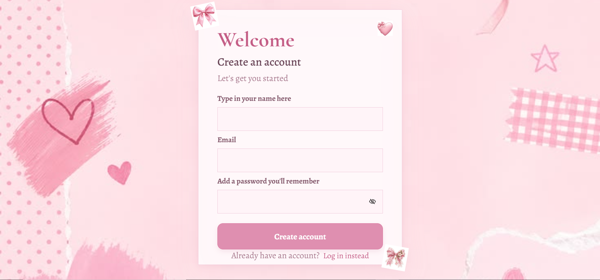
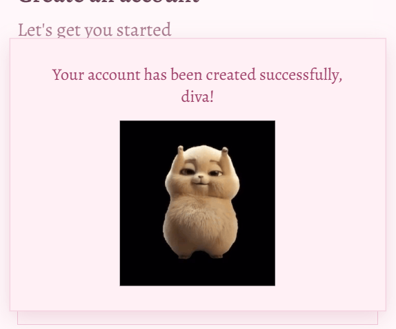

# Flip-Auth

* **Flip Auth** is a pink, coquette-inspired authentication interface featuring a 3D flipping card that switches between sign-up and login forms. I designed it cause I wanted to create cool stuff.
The design uses blush-pink colours, decorative bows and heart images, paper-inspired styling, and elegant typography.
Features
* **Flipping authentication card**: Switch between sign-up and login using a 3D flip animation.

* **Pink scrapbook aesthetic**:A decorative pink background with a soft card.
* **Coquette decorations**: Bow and heart images positioned around the card.
* **Password Visibility Toggle**: An eye/ eye-slash icon that lets the user show or hide their password input.
* **Interactive buttons and form fields**: Hover effects on the main action buttons and styled form fields.
* **Dancing gif** as a success message pop up(the thing I'm most proud of)

## Built With
- **HTML5**
- **CSS3**
- **JavaScript**
- **Google Fonts**

## Running  the Project
1. Clone or download this repository
https://github.com/Amanda101322/Flip-Auth
2. Open the project folder in your code editor.
3. Open index.html in a browser, or use a local development server.
4. Use the switch links to move between the sign-up and login sides.